### Tentang

Siswa **SMK Negeri 2 Magetan** — jurusan Teknik Komputer dan Jaringan. Fokus mengembangkan web: dari desain antarmuka, animasi, sampai sisi backend. Terbiasa belajar mandiri lewat dokumentasi dan membangun proyek pribadi.

- Sedang mendalami **React.js** dan **backend/API**
- Suka bikin antarmuka yang halus, responsif, dan enak dipakai
- Bisa dihubungi buat kerja sama proyek web

### Tech Stack

**Core Tech Stacks**

**Other Tech Stacks**

**Tools**

### Proyek

<table>
  <tr>
    <td width="50%">
      <h4><a href="https://reyzdev.my.id">Portofolio Pribadi</a></h4>
      
Next.js + Tailwind, animasi scroll dan galeri interaktif.

      <code>Next.js</code> <code>TypeScript</code> <code>Tailwind</code>
    </td>
    <td width="50%">
      <h4><a href="https://github.com/reyzdev/ascii-art-terminal">ASCII Art Terminal</a></h4>
      
Gambar, GIF, dan video jadi ASCII art berwarna di terminal.

      <code>Python</code> <code>Pillow</code> <code>ANSI</code>
    </td>
  </tr>
  <tr>
    <td width="50%">
      <h4><a href="https://github.com/reyzdev/portofolio-showcase">Portofolio (showcase)</a></h4>
      
Website portofolio: Next.js static export, deploy Cloudflare. Source privat.

      <code>Next.js</code> <code>TypeScript</code> <code>Cloudflare</code>
    </td>
    <td width="50%">
      <h4>Pengalaman &amp; Komunitas</h4>
      
UI/UX Designer Raion Internship, teknisi Lab TKJ, freelance web developer.

      <code>UI/UX</code> <code>Figma</code>
    </td>
  </tr>
</table>

### Pendidikan &amp; Pengalaman

| Jenjang | Sekolah | Tahun |
|---|---|---|
| SMK | **SMKN 2 Magetan** — Teknik Komputer &amp; Jaringan | 2024–2027 |
| SMP | **SMP Negeri 1 Kedunggalar**, Ngawi | 2021–2023 |
| SD | **SD Negeri Wonorejo 1** | 2015–2020 |

| Peran | Tempat | Tahun |
|---|---|---|
| Freelance Web Developer | Remote | 2024–sekarang |
| Teknisi Lab &amp; Asisten Praktikum | SMKN 2 Magetan | 2024–sekarang |
| UI/UX Designer | Raion Internship, Malang | 2026 |
| Network Management | PT Cubiespot Pilar Data Nusantara, Pasuruan | 2023 |

### Statistik

### Sorotan Repo

### Kontribusi

<picture>
  <source media="(prefers-color-scheme: dark)" srcset="https://raw.githubusercontent.com/reyzdev/reyzdev/output/bomberman-contribution-graph-dark.svg" />
  <source media="(prefers-color-scheme: light)" srcset="https://raw.githubusercontent.com/reyzdev/reyzdev/output/bomberman-contribution-graph.svg" />
  
</picture>

  Magetan, Jawa Timur · Indonesia

